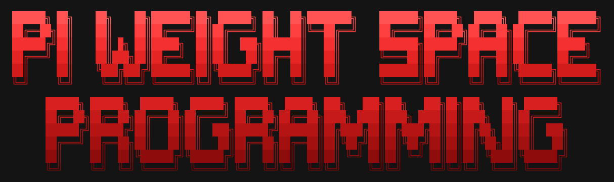
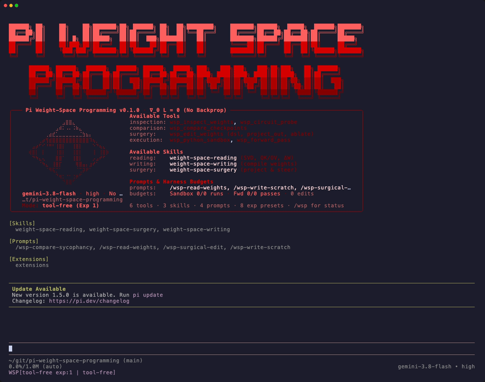

<p align="center">
  
</p>

# Pi Weight-Space Programming (π · WSP)

<p align="center">
  <a href="https://pi.dev">Pi Coding Agent</a> | <a href="https://rikiyat.github.io/blog/weight-space-programming/">Weight-Space Programming Paper</a> | <a href="https://github.com/RikiyaT/lm_understand-logs">Experiment Audit Logs</a>
</p>
<p align="center">
  <a href="https://pi.dev"></a>
  <a href="https://rikiyat.github.io/blog/weight-space-programming/"></a>
  <a href="https://github.com/RikiyaT/lm_understand-logs"></a>
  <a href="LICENSE"></a>
</p>

A [Pi](https://pi.dev) harness extension, tool suite, and skill collection for **Weight-Space Programming**—enabling language models to natively read, interpret, construct, and surgically edit neural network weights without gradient descent or fine-tuning.

Inspired by and adapted from the paper and experiment audit repository:
- **Paper / Blog Post**: [*Sparks of Weight-Space Programming: LLMs can natively read & write neural network weights*](https://rikiyat.github.io/blog/weight-space-programming/) by Rikiya Takehi, Jayden Teoh, Alex Zhang, and Omar Khattab (2026)
- **Original Experiment Logs & Codex Harness**: [`RikiyaT/lm_understand-logs`](https://github.com/RikiyaT/lm_understand-logs)

<p align="center">
  
</p>

<table>
<tr><td><b>Static Weight-Space Reading</b></td><td>Inspect <code>.safetensors</code> (<code>BF16</code>/<code>F16</code>/<code>F32</code>), <code>.npz</code>, and <code>.npy</code> checkpoints directly—computing SVD spectra, effective rank, QK/OV attention circuits, induction heads, and token projections with zero forward passes.</td></tr>
<tr><td><b>Direct Weight Compilation</b></td><td>Compile symbolic algorithms, coordinate trackers, boolean logic gates, and multi-step board propagation directly into neural network weight matrices from scratch without training.</td></tr>
<tr><td><b>Surgical Model Editing</b></td><td>Apply gradient-free weight edits via the <code>edits</code> DSL, directional subspace projection $W' = W - \alpha u(u^\top W)$, neuron/head ablation, or rank-one updates with verified <code>bfloat16</code> diff manifests.</td></tr>
<tr><td><b>Anti-Training Python Sandbox</b></td><td>Isolated CPU-only, network-disabled Python sandbox preloaded with <code>Checkpoint</code>, <code>Tokenizer</code>, <code>load()</code>, and <code>save_edit()</code>, with AST guards blocking <code>.backward()</code>, <code>torch.optim</code>, and regression fitting.</td></tr>
<tr><td><b>Paper Experiments 1–8 Presets</b></td><td>One-flag replication (<code>--wsp-exp 1..8</code>) configuring exact tool modes, reasoning effort (<code>high</code>, <code>xhigh</code>, <code>max</code>), sandbox run limits, forward-pass budgets, and <code>lm_understand-logs</code> audit traces.</td></tr>
</table>

---

## How This Differs from the Original Codex Setup

In [`RikiyaT/lm_understand-logs`](https://github.com/RikiyaT/lm_understand-logs), the model was run via `codex exec` with every built-in tool disabled (`harness/codex_config.toml`), relying on an external driver loop to parse markdown blocks (```` ```python ````, ```` ```edits ````, ```` ```forward ````, ```` ```attention ````).

This Pi harness extension supports **both** that strict zero-tool replication mode (`--wsp-mode tool-free`) **and** native, built-in Weight-Space Programming capabilities:

1. **Built-in Weight-Space Tools**:
   - `wsp_inspect_weights`: Inspects `.safetensors` (`BF16`/`F16`/`F32`), `.npz`, `.npy`, or checkpoint directories directly—computing tensor summaries, singular value spectra (`svd_spectrum`), effective rank / participation ratio, rounded slices (`slice`), and ASCII-safe token embedding projections (`vocab_projection`) without running a forward pass.
   - `wsp_circuit_probe`: Performs static weight-space mechanistic interpretability (`qk_ov_analysis`, static K-composition `induction_heads` detection as in Experiment 3, `mlp_directions` dominant write-direction & cross-layer alignment as in Experiment 8, and `subspace_rank` as in Experiment 3's Romaji analysis).
   - `wsp_compare_checkpoints`: Compares two checkpoints `A` and `B` in weight space (Experiment 7), identifying frozen vs. modified tensors, ranking layers/heads by relative Frobenius change, and computing the SVD spectrum of $\Delta W = W_B - W_A$.
   - `wsp_edit_weights`: Applies gradient-free surgical edits via the `edits` DSL (Experiments 4 & 5), directional subspace projection $W' = W - \alpha u(u^\top W)$ on top-$K$ columns (Experiment 8), unit/head ablation, or rank-one updates. Enforces protected-tensor guards (`embed_tokens`, `lm_head`, final `norm`, and pure scalar multiplication checks) and generates compact `sparse` / `lowrank` bfloat16 diff manifests (`manifest.json` + `edit.npz`).
   - `wsp_python_sandbox`: Executes Python in an isolated CPU-only, network-disabled sandbox preloaded with `Checkpoint`, `Tokenizer`, `load()`, `load_original()`, `save_edit()`, `drop_edit()`, `edited()`, `save()`, and `saved()`, while blocking gradient descent / training constructs (`.backward()`, `torch.optim`, `autograd`, `sklearn` fitting).
   - `wsp_forward_pass`: Tracks strict forward-pass budgets (e.g., 0, 10, 25, or 50 passes) for `attention_probe` (Experiment 7), `teacher_forced` (Experiment 8), `games_or_positions` (Experiment 6), and `paired_generate` (Experiment 8).
2. **Built-in Agent Skills**:
   - `weight-space-reading`: Methodology for reading input/output geometries, static $W_{QK}$/$W_{OV}$ circuit composition, and checkpoint comparison without forward passes.
   - `weight-space-writing`: Methodology for compiling symbolic algorithms, coordinate trackers, boolean gates, and multi-step board propagation directly into weight matrices from scratch.
   - `weight-space-surgery`: Four-step methodology for diagnosing failure modes, localizing responsible heads/MLP directions, applying minimal surgical projections or bypass paths, and verifying dose-response on paired samples.
3. **Audit Logging (`RikiyaT/lm_understand-logs` Format)**:
   - When `--wsp-log-dir <dir>` is passed, records per-turn audit traces (`turns/tNNN/{prompt.txt, answer.md, run.json}` with `audit.tool_free`, `tool_calls.jsonl`, `explanations.md`, `final_answer.md`, `state.json`, and `instructions.md`).

---

## Running Without Global Installation

It is **not** recommended to install this extension globally in `~/.pi/agent/settings.json`. Because this repository is configured as a full Pi package (with a `pi` manifest in `package.json`), you can install or configure it per-workspace via Git or a local directory, or load it per-invocation via CLI flags.

### Option 1: Configure as a Project-Local Package via Git (Recommended)

To configure the package for a specific workspace without installing it globally, you have two quick options:

#### A. Install via CLI (Fastest)

Run `pi install -l` inside your workspace directory:

```bash
mkdir my-wsp-workspace && cd my-wsp-workspace
pi install -l git:github.com/felipepenha/pi-weight-space-programming -a
```

This clones the repository into `my-wsp-workspace/.pi/git/` and configures `.pi/settings.json` automatically.

#### B. Manual `.pi/settings.json`

Create `.pi/settings.json` inside your working directory:

```text
my-wsp-workspace/
└── .pi/
    └── settings.json
```

Point `"packages"` to the Git repository:

```json
{
  "$schema": "https://pi.dev/schemas/settings.schema.json",
  "defaultTools": [],
  "defaultThinkingLevel": "high",
  "packages": [
    "git:github.com/felipepenha/pi-weight-space-programming"
  ]
}
```

*(Alternatively, HTTPS `https://github.com/felipepenha/pi-weight-space-programming.git` or SSH `git@github.com:felipepenha/pi-weight-space-programming.git` are also supported. For local development on cloned code, you can instead point to a local directory via `"packages": ["/path/to/pi-weight-space-programming"]` or `"extensions": ["/path/to/pi-weight-space-programming/extensions/index.ts"]`.)*

- Setting `"defaultTools": []` disables Pi's built-in file/shell tools (`read`, `bash`, `edit`, `write`) by default in that workspace while keeping all `wsp_*` extension tools active.
- Bundled skills (`/skill:weight-space-reading`, etc.) and prompt templates are discovered automatically from the package manifest.
- Run `pi` from inside `my-wsp-workspace/` (pass `--approve` / `-a` to trust project-local settings non-interactively):

```bash
cd my-wsp-workspace
pi -a
```

### Updating the Package

When this repository is configured as a Git package in your workspace, you can easily pull the latest updates, tool fixes, and skills:

```bash
# Update all project-local packages
pi update -a --extensions

# Or update this specific package
pi update -a git:github.com/felipepenha/pi-weight-space-programming

# Update both pi itself and all packages
pi update --all
```

Pi fetches the latest git commits, updates cached files, and reloads the extension, skills, and prompt templates on your next session.

### Option 2: Load Directly via CLI (`--extension` / `-e`)

If you have cloned the repository locally and want to load the extension for a single run without any workspace configuration files:

```bash
pi --no-builtin-tools -e /path/to/pi-weight-space-programming/extensions/index.ts
```

- `--no-builtin-tools` (`-nbt`) disables Pi's default file/shell coding tools (`bash`, `edit`, `write`, `read`) while keeping the extension's `wsp_*` tools active.
- All bundled skills (`/skill:weight-space-reading`, `/skill:weight-space-writing`, `/skill:weight-space-surgery`) and prompt templates (`/wsp-read-weights`, `/wsp-write-scratch`, `/wsp-surgical-edit`, `/wsp-compare-sycophancy`) are discovered automatically.

### Where to Place Your Model / Checkpoint Files

You can place your target model files (`.safetensors`, `.npz`, `.npy`, or a Hugging Face model directory containing `model.safetensors`, `config.json`, and `tokenizer.json`) **anywhere inside your workspace** (e.g. `my-wsp-workspace/models/`) or at any path on disk. The extension resolves model checkpoints in three ways:

1. **Pass `--wsp-model-path` at startup (Recommended for single-model sessions)**:
   ```text
   my-wsp-workspace/
   ├── .pi/
   │   └── settings.json
   └── models/
       └── my_network.npz        # or a folder with model.safetensors + tokenizer.json
   ```
   ```bash
   cd my-wsp-workspace
   pi -a --wsp-model-path ./models/my_network.npz
   ```
   When `--wsp-model-path` is set:
   - All tools (`wsp_inspect_weights`, `wsp_circuit_probe`, `wsp_edit_weights`, `wsp_forward_pass`) **automatically default** to that checkpoint without needing the path repeated in every prompt.
   - Inside `wsp_python_sandbox`, `MODEL_PATH` is automatically bound to that path (and for `.npz` checkpoints with $\le 64$ tensors, `W` is pre-loaded as a dictionary of NumPy arrays).

2. **Reference the path directly in your chat prompt (No CLI flag needed)**:
   If you start `pi` without `--wsp-model-path`, simply mention the relative or absolute path in chat (e.g., *"Inspect `./models/my_network.npz` and check its attention heads"* or *"Compare `./models/base.safetensors` and `./models/finetuned.safetensors`"*). Every `wsp_*` tool accepts a `checkpoint` argument (`checkpoint_a` / `checkpoint_b` for comparisons) and resolves relative paths against your current working directory.

3. **Writing weights from scratch (No existing model file needed)**:
   When compiling a network from scratch (such as Experiments 5 and 6), no input model file is required—`wsp_edit_weights` (`init_shapes`) and `wsp_python_sandbox` (`save_weight(...)`) write newly synthesized `.npz` / `.npy` files directly into `<workspace>/.wsp-work/` (or the directory passed to `--wsp-work-dir`).

### Running Specific Paper Experiments (Experiments 1–8)

Whether loaded via `.pi/settings.json` (Option 1) or `-e` (Option 2), use `--wsp-exp <1..8>` to configure the exact harness mode, thinking level (`high`, `xhigh`, `max`), sandbox run limit, forward-pass budget, and `EXPLAIN EVERY STEP` enforcement from the paper:

```bash
# Experiment 1: Read raw policy weights in strict tool-free mode (effort: high)
pi -a --wsp-exp 1 \
  --wsp-log-dir ./logs/exp1_run \
  -p @prompt.txt

# Experiment 3: Identify language & copying heads from middle transformer blocks (effort: xhigh, 0 forward passes)
pi -a --wsp-exp 3 \
  --wsp-model-path ./networks/python/blocks.npz \
  --wsp-log-dir ./logs/exp3_python

# Experiment 7: Compare two checkpoints A and B for sycophancy (effort: xhigh, max 20 runs)
pi -a --wsp-exp 7 \
  --wsp-log-dir ./logs/exp7_pair1

# Experiment 8: Surgical weight editing for math reasoning (effort: max, 50 forward passes, EXPLAIN EVERY STEP)
pi -a --wsp-exp 8 \
  --wsp-model-path ./base_model/model.safetensors \
  --wsp-work-dir ./.wsp-work/p50 \
  --wsp-log-dir ./logs/exp8_p50
```

### Model & Reasoning Effort Configuration

The extension works with any model provider configured in Pi (`google`, `openai`, `anthropic`, etc.). It uses your configured default model automatically, or you can set `defaultProvider` / `defaultModel` in `<workspace>/.pi/settings.json` or pass `--model` per invocation:

```bash
# Use your default configured model with xhigh thinking effort
pi -a --wsp-mode mech-interp --wsp-effort xhigh

# Explicitly specify a model and thinking level via Pi's --model flag
pi -a --model google/gemini-3.8-flash:high
pi -a --model google/gemini-3.1-pro-preview:xhigh
```

---

## Harness Modes, CLI Flags & Slash Commands

### Harness Modes (`--wsp-mode <mode>` or `/wsp-mode <mode>`)

| Mode | Active Tools | Thinking Level | System Prompt | Purpose |
|---|---|---|---|---|
| `full` *(default)* | All 6 `wsp_*` tools | `high` | WSP guidelines | Interactive weight-space exploration, circuit analysis, and editing |
| `tool-free` | None (`audit.tool_free = true`) | `high` | Neutral 1-line (`harness/instructions.md`) | Pure in-context weight reading & one-shot `edits` writing (Exps 1, 2, 4, 5) |
| `sandbox` | `wsp_python_sandbox`, `wsp_inspect_weights`, `wsp_edit_weights`, `wsp_forward_pass` | `xhigh` | WSP guidelines | From-scratch large network construction & budgeted passes (Exp 6) |
| `mech-interp` | `wsp_inspect_weights`, `wsp_circuit_probe`, `wsp_compare_checkpoints`, `wsp_python_sandbox`, `wsp_forward_pass` | `xhigh` | WSP + `EXPLAIN EVERY STEP` | Transformer circuit analysis & checkpoint comparison (Exps 3, 7) |
| `surgical-edit` | `wsp_inspect_weights`, `wsp_circuit_probe`, `wsp_edit_weights`, `wsp_python_sandbox`, `wsp_forward_pass` | `max` | WSP + `EXPLAIN EVERY STEP` | Targeted weight surgery with diff manifests (Exps 4, 8) |

### CLI Flags

| Flag | Description |
|---|---|
| `--wsp-mode <mode>` | Set harness mode: `full`, `tool-free`, `sandbox`, `mech-interp`, `surgical-edit` |
| `--wsp-exp <1..8>` | Load paper Experiment `1`–`8` preset (mode, effort, run limit, pass budget) |
| `--wsp-effort <level>` | Override thinking level: `off`, `minimal`, `low`, `medium`, `high`, `xhigh`, `max` |
| `--wsp-model-path <path>` | Default checkpoint path (`.safetensors`, `.npz`, `.npy`, or model directory) |
| `--wsp-work-dir <path>` | Persistent `/work` directory for sandbox runs and edited tensors (default: `./.wsp-work`) |
| `--wsp-log-dir <path>` | Directory to write `lm_understand-logs`-compatible audit files |
| `--wsp-pass-budget <n>` | Set forward-pass budget (e.g., `0`, `10`, `25`, `50`) |
| `--wsp-max-runs <n>` | Set maximum Python sandbox runs (e.g., `20`, `100`, `120`, `300`) |
| `--wsp-explain-steps` | Require plain-English hypothesis explanation before each step |
| `--wsp-no-header` | Disable the colorful Weight-Space Programming ASCII startup banner in the TUI |

### Slash Commands

- `/wsp`: Display current Weight-Space Programming mode, active model, thinking effort, sandbox/pass budgets, and edited tensors.
- `/wsp-mode <mode>`: Switch harness mode mid-session.
- `/wsp-exp <1..8>`: Switch to an Experiment 1–8 configuration mid-session.
- `/wsp-apply-edits <checkpoint> [output.npz]`: Parse the last ```` ```edits ```` block from the assistant's reply (in `tool-free` mode) and apply it to `<checkpoint>`, producing `<output.npz>` and a verified diff manifest.
- `/wsp-reset`: Reset sandbox run counters, forward-pass counters, and session audit state.
- `/wsp-header [on|off|toggle]`: Toggle between the colorful Weight-Space Programming ASCII startup banner and Pi's built-in header.

---

## Python Environment Requirements

The Python engine (`harness/wsp_engine.py` and `harness/prelude.py`) requires Python 3 and `numpy` (it reads `bfloat16`/`float16`/`float32` `.safetensors`, `.npz`, `.npy`, and `tokenizer.json` natively in pure NumPy without requiring PyTorch or Hugging Face libraries).

The extension resolves Python automatically in this order:
1. `$WSP_PYTHON` environment variable (if set)
2. `./.venv/bin/python` (if a project virtual environment exists)
3. System `python3` (if `numpy` is installed)
4. `uv run --offline --python 3.12 --with numpy python3` / `uv run --python 3.12 --with numpy python3`

---

## Tests & Paper Benchmark Evaluations

See [`evals/README.md`](evals/README.md) for the complete functional test suite (`evals/functional/`) and preserved paper benchmark evaluation logs (`evals/runs/`) across Experiments 1–5.

---

## License & Attributions

This repository is licensed under the **Apache License 2.0** (see [`LICENSE`](LICENSE) and [`NOTICE`](NOTICE)).

### Attribution to *Sparks of Weight-Space Programming* (`RikiyaT/lm_understand-logs`)

This project adapts harness designs, sandbox prelude helpers, pure-NumPy `safetensors` bfloat16/float32 utilities, and compact sparse/low-rank weight-edit manifest scripts from [`RikiyaT/lm_understand-logs`](https://github.com/RikiyaT/lm_understand-logs), accompanying the paper [*Sparks of Weight-Space Programming: LLMs can natively read & write neural network weights*](https://rikiyat.github.io/blog/weight-space-programming/) by **Rikiya Takehi, Jayden Teoh, Alex Zhang, and Omar Khattab**.

In accordance with [`RikiyaT/lm_understand-logs/blob/main/LICENSE`](https://github.com/RikiyaT/lm_understand-logs/blob/main/LICENSE):

1. **Adapted Scripts (`harness/prelude.py`, `harness/wsp_engine.py`) — MIT License**:
   > Copyright (c) 2026 the authors of "LLMs can understand and write neural network weights"
   >
   > Permission is hereby granted, free of charge, to any person obtaining a copy of this software and associated documentation files (the "Software"), to deal in the Software without restriction, including without limitation the rights to use, copy, modify, merge, publish, distribute, sublicense, and/or sell copies of the Software, and to permit persons to whom the Software is furnished to do so, subject to the following conditions:
   >
   > The above copyright notice and this permission notice shall be included in all copies or substantial portions of the Software.
   >
   > THE SOFTWARE IS PROVIDED "AS IS", WITHOUT WARRANTY OF ANY KIND, EXPRESS OR IMPLIED, INCLUDING BUT NOT LIMITED TO THE WARRANTIES OF MERCHANTABILITY, FITNESS FOR A PARTICULAR PURPOSE AND NONINFRINGEMENT. IN NO EVENT SHALL THE AUTHORS OR COPYRIGHT HOLDERS BE LIABLE FOR ANY CLAIM, DAMAGES OR OTHER LIABILITY, WHETHER IN AN ACTION OF CONTRACT, TORT OR OTHERWISE, ARISING FROM, OUT OF OR IN CONNECTION WITH THE SOFTWARE OR THE USE OR OTHER DEALINGS IN THE SOFTWARE.

2. **Experiment Specifications, Prompts, and `harness/instructions.md` — CC BY 4.0**:
   - Experiment setups, prompt protocols, and `harness/instructions.md` from [`RikiyaT/lm_understand-logs`](https://github.com/RikiyaT/lm_understand-logs) by the authors of *"LLMs can understand and write neural network weights"* (Rikiya Takehi, Jayden Teoh, Alex Zhang, and Omar Khattab) are licensed under the [Creative Commons Attribution 4.0 International License (CC BY 4.0)](https://creativecommons.org/licenses/by/4.0/legalcode). Changes were made to adapt the harness protocols and workflows into a Pi coding agent extension with built-in tools and skills.
   - No GPL-3.0 MinAtar source code from `exp5_write_from_scratch` is included in this repository.
